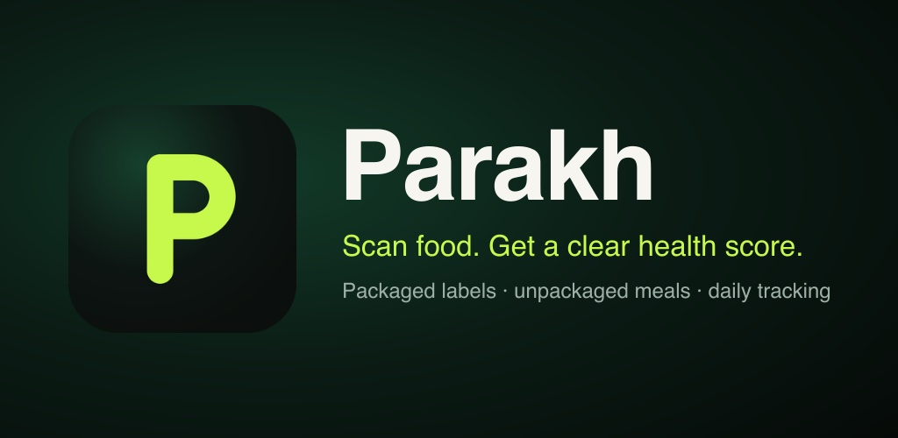
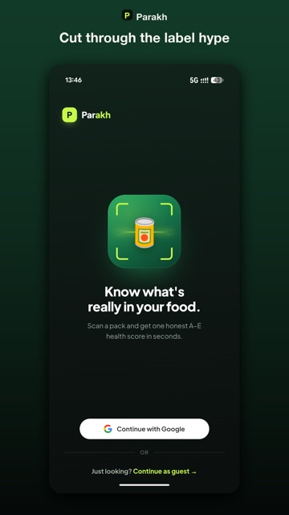
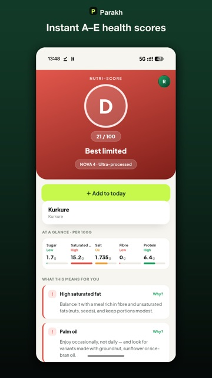
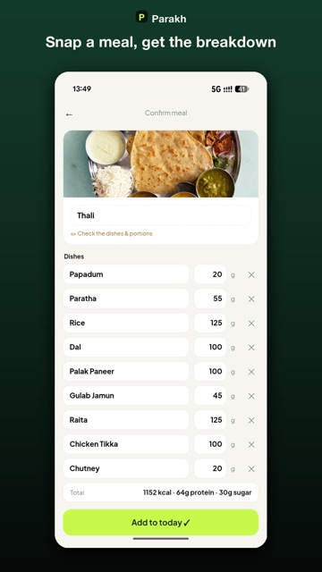
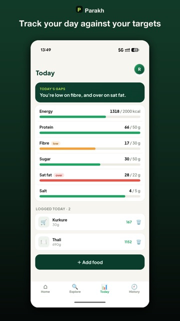

<p align="center"></p>

# Parakh

[](https://github.com/rsumit123/parakh/actions/workflows/ci.yml)

**Parakh** (परख, "to assess quality") gives packaged Indian food a single, honest A–E health score. Scan a barcode or photograph the label to get a 0–100 verdict, see *why* it scored that way, and find healthier like-for-like swaps. You can also snap a home-cooked meal or a thali and track the day against your nutrition targets.

**Live:** [parakh.skdev.one](https://parakh.skdev.one) (installable PWA; sign in with Google or continue as a guest)

<p align="center">
  
  
  
  
</p>

## How it works

```
 barcode ──▶ our DB ──hit──────────────────────────────▶ score + breakdown
               │ miss
               ▼
         OpenFoodFacts ──usable nutrition──▶ score ──▶ cache in DB
               │ miss / empty
               ▼
       label photo ──▶ vision LLM extracts nutrition + ingredients ──▶ score ──▶ cache in DB
```

- **The LLM extracts, a deterministic function scores.** A vision model (via OpenRouter) only *reads* the nutrition table and ingredient list. Scoring is plain Python: a Nutri-Score backbone (sugar, salt and saturated fat against fibre and protein) mapped to 0–100, minus India-specific penalties for palm oil, maida and additives, plus NOVA-4 ultra-processing markers. The same product always gets the same, explainable score.
- **Scored once, cached forever.** Every newly resolved product is written back, so the next scan of it is an instant DB hit. Cached rows with no usable nutrition are treated as misses and self-heal on the next scan.
- **Healthier swaps by meaning, not keywords.** Products are embedded, and alternatives are ranked by cosine similarity, so swaps stay like-for-like (buttermilk → chaas, 70% → 90% dark chocolate). If embeddings are unavailable, it falls back to score order.
- **Meals, not just packets.** A meal photo is split into individual dishes, each with a typical portion and per-100 g macros. You confirm or adjust the portions, then log it against daily targets for energy, protein, fibre, sugar, saturated fat and salt.
- **A seeded catalog.** About 1,000 products from Indian e-commerce listings were run through a batch extraction pipeline so Explore and Compare work without scanning first ([`docs/catalog-data-pipeline.md`](docs/catalog-data-pipeline.md)).
- **Fair quotas.** Guests get 3 scans a day and signed-in users get 10. Quota is consumed only on a successful scan, so "needs a photo" or "unreadable label" never burns your allowance.

## Stack

| Layer | Technology |
|---|---|
| Backend | Python, FastAPI, SQLAlchemy 2, SQLite, httpx |
| AI | OpenRouter vision models (label and meal extraction), OpenAI embeddings (swaps) |
| Frontend | React 18, TypeScript, Vite, PWA (vite-plugin-pwa), @zxing barcode scanning |
| Auth | Google Sign-In or guest device tokens, JWT |
| Data | OpenFoodFacts, plus a seeded catalog |
| Hosting | Vercel (frontend), Docker on a GCP VM behind nginx (backend) |
| Quality | pytest (166 tests), Vitest + Testing Library (156 tests), GitHub Actions CI |

## Repository layout

```
backend/
  app/
    scoring/        nutriscore.py + scorer.py: the deterministic scoring
    services/       scan pipeline, meal estimator, auth, rate limiter
    clients/        OpenFoodFacts + vision label extractor
    repositories/   products, diet log
    nutrition/      daily targets
  scripts/          catalog build / seed / backfill tooling
  tests/
frontend/
  src/
    screens/        Scan, Result, Compare, Explore, Today, Meal capture, History…
    scan/           camera + barcode decoding
    api/ session/ diet/ components/
docs/               catalog pipeline runbook, research, design specs
```

## Run locally

```bash
# Backend (terminal 1)
cd backend && python -m venv .venv && source .venv/bin/activate
pip install -e ".[dev]"
cp .env.example .env          # set PARAKH_SECRET_KEY; PARAKH_OPENROUTER_API_KEY enables the photo path
uvicorn app.main:app --port 8000

# Frontend (terminal 2)
cd frontend && npm install
echo 'VITE_API_BASE_URL=http://localhost:8000' > .env.local
npm run dev
```

Open http://localhost:5173.

## Tests

```bash
cd backend && pytest -q       # 166 tests
cd frontend && npm test       # 156 tests
```

CI runs both suites and a production frontend build on every push.

See [`backend/README.md`](backend/README.md) for the API reference.
